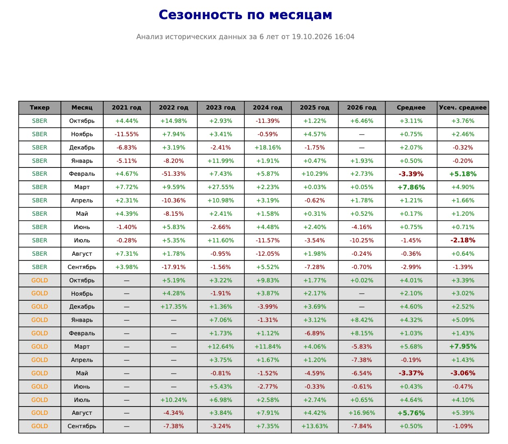
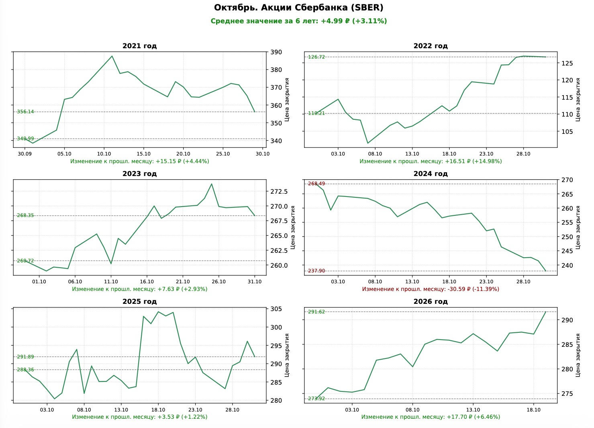

# season-months — seasonal analysis of exchange-traded instruments

**Information generated by this software (algorithms) is not individual investment advice. You make financial decisions independently and at your own risk.**

*This software is provided "as is", without warranty of any kind, express or implied, including but not limited to the warranties of merchantability, fitness for a particular purpose and noninfringement. In no event shall the authors or copyright holders be liable for any claim, damages or other liability arising from the use of this software.*

The program computes **monthly seasonality**: for each exchange-traded instrument
it determines how its price has typically changed in a given calendar month over
several years of history, and assembles the results into a ready **PDF report**
with a summary table and detailed per-month charts.

Data comes **only from local files** in the `txt/` folder — the program downloads
nothing and never touches the network.

## 🖼️ Report samples

<div align="center">


&nbsp; &nbsp; &nbsp; &nbsp;


</div>

---

## How it works

The program runs three stages:

| Stage | Module | What it does |
| ------ | -------- | ----------- |
| 1 | `loader.py` | Reads daily quotes from `txt/` into pandas data frames, detects the delimiter, parses dates, filters the period |
| 1 | `analytics.py` | Computes each calendar month's return, the mean and trimmed mean across years, finds the best and worst months |
| 2 | `report.py` | Draws the summary return tables into the PDF (24 rows per sheet) |
| 3 | `report.py` | Draws one page per month for every active instrument: a grid of 6 mini-charts, one per year |

The stages are orchestrated by `main.py` — the entry point.

## Project structure

```
season-months/
├── main.py            # entry point: stages 1–3, run: python3 main.py
├── config.py          # ALL settings: period, instrument registry, calendar
├── logging_utils.py   # project folders and the monthly log
├── loader.py          # stage 1: reading quotes from txt/
├── analytics.py       # math core: returns, means, extremes
├── report.py          # stages 2–3: PDF rendering (tables and charts)
├── txt/               # INPUT data — daily quotes (you put them here)
├── logs/              # run logs (one file per month, created automatically)
└── reports/           # finished PDF reports (created automatically)
```

The service folders `txt/`, `logs/`, `reports/` are created automatically next to
`main.py`, so the script can be run from any directory.

## Requirements and running

- Python 3.10+ (tested on 3.12)
- pandas 2.x, matplotlib 3.8+ (`pip install pandas matplotlib`)

```bash
cd <project folder>
python3 main.py
```

When the run finishes, the ready report appears in
`reports/YYYY-MM-DD-Season-months.pdf`, and progress messages are printed to the
console and written to the log.

---

## Configuration (config.py)

All settings live in a single module — edit only it, no code changes are needed.

### `START_FETCH_DATE = "2021-01-01"`

The reference point of the analysis period. Data is actually loaded **one month
earlier** (from 2020-12-01): the return of January 2021 must be measured against
the December 2020 close, not against the first bar of January itself — otherwise
the first month's return would be distorted. The shift is performed by
`loader.load_start()`.

### `TARGET_YEARS = [2021, 2022, 2023, 2024, 2025, 2026]`

The list of historical years to analyse. It determines:

- the columns «2021 год … 2026 год» in the summary table;
- the number of mini-charts on a detail page (one per year, laid out in
  2 columns);
- the range of years the mean is computed over.

The number of years can be anything — the page grid rebuilds automatically and
extra empty cells are hidden.

### `TICKERS_CONFIG`

The registry of instruments under analysis — a list of dictionaries. Each entry
describes one instrument:

| Field | Type | Purpose |
| ------ | ----- | ----------- |
| `ticker` | str | Instrument code. Also: the basis of the data file name (`SBER-all-d.txt`), the expected price column name in the txt file, the label in the table |
| `market` | str | Exchange section — reference only (`TQBR` — stocks/funds of the Moscow Exchange, `FORTS` — derivatives market). Does not affect calculations |
| `name` | str | Human-readable name — the heading of the detail page |
| `unit` | str | Measurement unit in change captions: `₽`, `$`, `п.`, etc. |
| `color` | str | Color of the chart line and of the ticker name in the table (any matplotlib color name: `seagreen`, `darkorange`, …) |
| `plot_charts` | bool | `True` — the instrument gets detailed monthly pages (stage 3). `False` — a summary-table row only. All loaded instruments appear in the table regardless of this flag |

The active set:

| ticker | name | market | unit | color | plot_charts |
| -------- | ------ | -------- | ------ | ------- | ------------- |
| SBER | Акции Сбербанка (SBER) | TQBR | ₽ | seagreen | **True** |
| GOLD | Фонд ВИМ Золото (GOLD) | TQBR | ₽ | darkorange | False |
| MOEX | Акции Московской биржи (MOEX) | TQBR | ₽ | darkblue | False |
| MTSS | Акции МТС (MTSS) | TQBR | ₽ | DarkTurquoise | False |
| Si | Фьючерс Доллар-Рубль (Si) | FORTS | ₽ | darkgreen | False |
| CR | Фьючерс Юань-Рубль (CR) | FORTS | ₽ | darkgreen | **True** |
| GD | Фьючерс Золото (GD) | FORTS | $ | darkorange | False |
| SV | Фьючерс Серебро (SV) | FORTS | $ | slategray | **True** |
| PT | Фьючерс Платина (PT) | FORTS | $ | chocolate | **True** |
| NG | Фьючерс Природный газ (NG) | FORTS | $ | DarkTurquoise | **True** |

Note: `name` values are displayed in the report exactly as written in the config —
currently in Russian.

To add an instrument: append a dictionary to `TICKERS_CONFIG` and put its txt
file into `txt/` — nothing else needs changing.

### `MONTHS_RU`

A dictionary of Russian month names `{1: 'Январь', …, 12: 'Декабрь'}` — used in
table rows and page headings.

### `months_order(start_month=None)` and `build_months_to_analyze(start_month=None)`

Calendar helpers. `months_order()` returns the month order starting from the
current calendar month: in October the analysis runs October → November →
December → January → … → September. `build_months_to_analyze()` wraps it into a
list of `{'number': …, 'name': …}` pairs. This order defines the row sorting of
the summary table and the page sequence of stage 3.

---

## Input data (txt/ folder)

For every instrument from `TICKERS_CONFIG` the program looks for a file:

1. `<ticker>-all-d.txt` — full archive of daily quotes (preferred);
2. `<ticker>-d-5y.txt` — quotes for the last few years (fallback).

Content requirements:

- **the first line** is a header with `Date` and `Close` columns (case does not
  matter; a column named after the ticker code will do instead of `Close`);
- **delimiter** — tab, `;` or comma, detected automatically from the first line
  of the file;
- **dates** — in ISO format (`2026-10-16`), one row per trading day;
- other columns are ignored.

Example data row (comma): `2026-10-16,301.25`

If an instrument's file is missing or contains no recognizable columns, the
instrument is skipped with a warning in the log; if not a single file is found,
the program stops with an error.

---

## Report (reports/YYYY-MM-DD-Season-months.pdf)

The report itself (headings, table captions, notes) is rendered in Russian.

### Summary tables (stage 2)

- Columns: **Ticker, Month, [each year from `TARGET_YEARS`], Mean, Trimmed mean**
  (in Russian: «Тикер», «Месяц», «2021 год» …, «Среднее», «Усеч. среднее»).
- Rows are grouped by instrument, months follow `months_order()`; 24 rows per
  sheet.
- Formatting: alternating row background, the ticker name in the instrument's
  color, gains in green, losses in red, the best and worst months in bold.
- The methodology footnote about the trimmed mean is on the last sheet.

### Detail pages (stage 3)

One page per month for every instrument with `plot_charts: True`:

- heading «Месяц. Instrument name»;
- a line «Среднее значение за N лет: +X.XX ₽ (+Y.YY%)» — over all years with data;
- a mini-chart grid, 2 columns × 3 rows — one chart per year: the price line
  within the month starting from the anchor bar (the previous month's close),
  dashed levels of the base and final price with value labels, and at the bottom
  the change in currency and in percent.

Volume example: 10 instruments in the table (5 sheets) + 5 instruments with
`plot_charts: True` × 12 months (60 pages) = **65 pages**.

## Logs (logs/)

The file `logs/YYYY-MM-season-months.log` — one per launch month, no rotation.
Each record: `[YYYY-MM-DD HH:MM:SS] message`. Everything printed to the console
is duplicated into the log, plus messages without console output.

---

## Calculation methodology

- **Monthly return** — the change against the close of the last trading day of
  the *previous* month: `(month close − previous month close) / previous month
  close × 100%`. For the very first month of the period (January 2021) the base
  is the first bar of the month itself.
- **Mean** — the arithmetic mean of the month's returns across all
  `TARGET_YEARS` years that have data. The current incomplete month is shown in
  the table and **participates in the mean** on equal terms with completed ones.
- **Trimmed mean** — with 3 or more values, one minimum and one maximum are
  discarded and the mean is computed over the rest; with 1–2 values it equals the
  plain mean.
- **Extremes** — the months with the maximum and minimum mean (and trimmed mean)
  per instrument; shown in bold in the table.
- **Zero base price** — the return is marked n/a (division-by-zero protection,
  relevant for futures with negative prices).
- Days without trading (an empty month in the data) are marked with a dash «—»
  and are not included in the mean.
